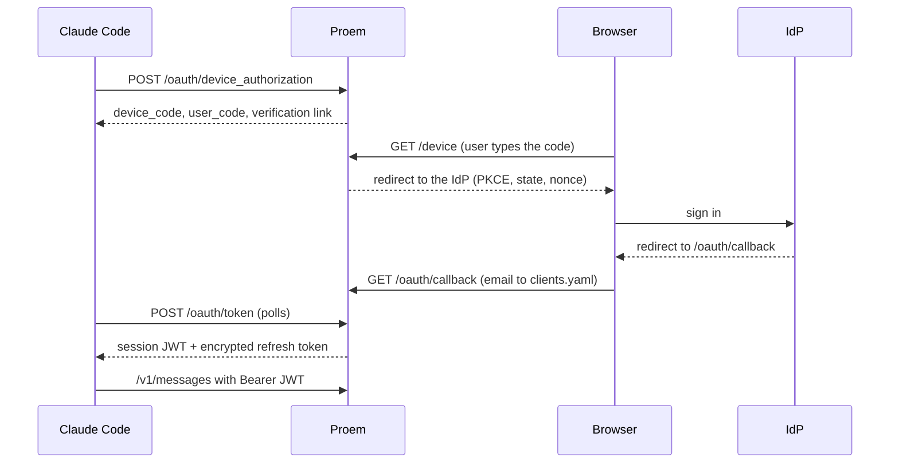

Proem can act as the Claude Code enterprise gateway. A user runs `/login` in
Claude Code, signs in with your OpenID Connect provider (Keycloak or Google) in
the browser, and Claude Code receives a short-lived Proem session token. The
user does not hold a static `sk-ant-oat01-` token.

Each request maps the verified email of the user to one client in
`clients.yaml`. Usage, metrics and sticky routing use that client name, as
they do for token clients. Token clients continue to work with no change.



The gateway is off unless you set `--public-url`.

## Add users

Give each person one entry with an `email`. A client can have an `email`, a
`tokenSHA256`, or both.

```yaml
clients:
  - name: alice
    email: alice@example.com
  - name: agent-ci
    tokenSHA256: 0000000000000000000000000000000000000000000000000000000000000001
```

Proem compares emails without case. Two clients cannot have the same email.
Only a user whose verified email matches an entry gets a token.

To remove access, delete the entry or set `enabled: false`. Proem refuses the
next request from that user (401 or 403). A refresh after that also fails, so
Claude Code asks the user to run `/login` again.

## Register Proem at the IdP

Register a confidential client. Use this redirect URI:

```
{public-url}/oauth/callback
```

### Keycloak

- Client `proem`: confidential, standard flow on, PKCE method `S256`.
- Add `offline_access` to the scopes:
  `OIDC_SCOPES=openid,email,profile,offline_access`. Without it, the refresh
  token ends with the SSO session (Keycloak default: 30 minutes idle, 10 hours
  maximum), and a laptop that sleeps overnight must `/login` every day.
- Set the realm option **Revoke Refresh Token** to off. If it is on, two Claude
  Code processes on one laptop that refresh at the same time log the user out.
- Offline sessions survive "log out" and "end sessions" in the admin console.
  To remove a user, disable the user or revoke their offline sessions.

### Google

- Issuer `https://accounts.google.com`.
- Google gives a refresh token only with
  `OIDC_AUTH_PARAMS=access_type=offline,prompt=consent`.
- Set `OIDC_ALLOWED_DOMAIN` to your Workspace domain. Proem then checks the
  email domain and the `hd` claim.

## Configure Proem

```bash
export OIDC_CLIENT_ID=proem
export OIDC_CLIENT_SECRET=...            # from your secret store
export PROEM_JWT_SECRET=...              # 32 bytes or more
export PROEM_REFRESH_KEY=$(openssl rand -base64 32)

proem --config pool.yaml --clients clients.yaml \
  --redis-url redis://redis:6379/0 \
  --public-url https://proem.example.com \
  --oidc-issuer https://keycloak.example.com/realms/corp
```

The gateway needs Redis for login. Proem does not start when the gateway is on
and Redis does not answer. After startup, a Redis outage stops new logins and
refreshes (503). Requests with a valid session token continue to work.

The public URL must use `https://`, unless the host is a loopback address.
Terminate TLS at an ingress, or let Proem serve TLS with `--tls-cert` and
`--tls-key`. Claude Code pins the TLS leaf certificate at the first login, so a
certificate change makes each user accept the new certificate.

[Configuration](../reference/configuration.md) lists every option.

## Configure Claude Code

Set these values in the managed settings of each laptop:

```json
{
  "forceLoginMethod": "gateway",
  "forceLoginGatewayUrl": "https://proem.example.com"
}
```

Claude Code accepts `forceLoginGatewayUrl` only from managed settings.

## Sessions

| Value | Default | Meaning |
|---|---|---|
| `--session-ttl` | `1h` | The lifetime of a session token. Claude Code refreshes it 5 minutes before it expires. |
| `--session-max` | `720h` | The maximum time from the SSO login to the last refresh. After that, the user must `/login` again. |

At each refresh, Proem refreshes with the IdP, checks that the subject did not
change, and checks `clients.yaml` again. If you disable the user at the IdP,
access stops at the next refresh, so in at most `--session-ttl`.

## Rotate keys

`PROEM_JWT_SECRET` and `PROEM_REFRESH_KEY` are comma-separated lists. The first
key signs or encrypts; every key verifies or decrypts. To rotate, put the new
key first, keep the old key for one `--session-max`, then remove it.

## Security

- The confirm page at `/device` tells the user to continue only if they just
  ran `/login`. It shows when and from which address the request started. The
  user must type the code from the terminal. A link with the code in it does
  not approve a login by itself. This stops device-code phishing.
- `/device` is rate limited per IP (`--device-rate-limit`).
- The IdP refresh token is stored only encrypted.
- Proem never logs a token. A rejected token is logged as a short fingerprint.
